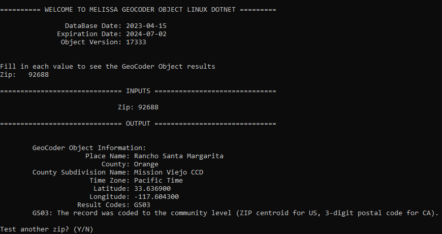

# Melissa - GeoCoder Object Linux Dotnet

## Purpose
This code showcases the Melissa GeoCoder Object using C#.

Please feel free to copy or embed this code to your own project. Happy coding!

To view the latest Melissa GeoCoder Object release notes or to subscribe to product notifications, please visit: https://releasenotes.melissa.com/on-premise-api/geocoder-object/

For further details, please visit: https://docs.melissa.com/on-premise-api/geocoder-object/geocoder-object-quickstart.html

The console will ask the user for:
- Zip 

And return 

For US:

- Place Name
- County
- County Subdivision Name
- Time Zone
- Latitude
- Longitude
- Result Codes

For Canada:

- Time Zone
- Latitude
- Longitude

## Tested Environments
- Linux 64-bit .NET 10.0, Ubuntu 20.04.05 LTS
- Melissa data files for 2026-Q3

## Required File(s) and Programs

#### libmdGeo.so

This is the code of the Melissa Object.

#### Data File(s)
  - mdGeoCode.db3

## Getting Started
These instructions will get you a copy of the project up and running on your local machine for development and testing purposes.

#### Install .NET SDK
Before starting, check to see if you already have .NET SDK already installed by entering this command:

`dotnet --list-sdks`

If .NET SDK is already installed, you should see it listed.

To download, run the following commands to add the Microsoft package signing key to your list of trusted keys and add the package repository.

```
wget https://packages.microsoft.com/config/ubuntu/20.04/packages-microsoft-prod.deb -O packages-microsoft-prod.deb
sudo dpkg -i packages-microsoft-prod.deb
rm packages-microsoft-prod.deb
```

Next, you can now run this command to install your desired .NET SDK (replace <VERSION> with .NET version: 10.0, etc.):

```
sudo apt-get update && \
  sudo apt-get install -y dotnet-sdk-<VERSION>
```

Once all of this is done, you should be able to verify that the SDK is installed with the `dotnet --list-sdks` command.

----------------------------------------

#### Download this project
```
git clone https://github.com/MelissaData/GeoObject-Dotnet-Linux
cd GeoObject-Dotnet-Linux
```

#### Set up Melissa Updater
Melissa Updater is a CLI application allowing the user to update their Melissa applications/data.

- In the root directory of the project, create a folder called `MelissaUpdater` by using the command: 

  `mkdir MelissaUpdater`

- Enter the newly created folder using the command: 

  `cd MelissaUpdater`
  
- Proceed to install the Melissa Updater using the curl command:

  `curl -L -O https://releases.melissadata.net/Download/Library/LINUX/NET/ANY/latest/MelissaUpdater`
  
- After the Melissa Updater is installed, you will need to change the Melissa Updater to an executable using the command: 

  `chmod +x MelissaUpdater`

- Now that the Melissa Updater is set up, you can now proceed to move back into the project folder by using the command:
  
   `cd ..`
----------------------------------------

#### Different ways to get data file(s)
1. Using Melissa Updater
	- It will handle all of the data download/path and dll(s) for you.
2. If you already have the latest release zip, you can find the data file(s) in there
    - To pass in your own data file path directory, you may either use the '--dataPath' parameter or enter the data file path directly in interactive mode.
    - Comment out this line "DownloadDataFiles $license" in the bash script.
    - This will prevent you from having to redownload all the files.

#### Change Bash Script Permissions
To be able to run the bash script, you must first make it an executable using the command:

`chmod +x MelissaGeoCoderObjectLinuxDotnet.sh`

As an indicator, the filename will change colors once it becomes an executable.

## Run Bash Script
Parameters:
- --zip: a test zip code

   - For US: zip code format can be 5-digit or 9-digit, with or without hyphen(-) delimiter

   - For Canada: zip code format must be a full 6-digit Canadian Postal Code, with or without a space

  This is convenient when you want to get results for a specific zip code in one run instead of testing multiple zip codes in interactive mode.

- --dataPath (optional): a data file path directory to test the GeoCoder Object
- --license (optional): a license string to test the GeoCoder object
- --quiet (optional): add to the command if you do not want to get any console output from the Melissa Updater.

When you have modified the script to match your data location, let's run the script.
There are two modes:
- Interactive

  The script will prompt the user for a zip code, then use the provided zip to test GeoCoder Object. For example:
  ```
  ./MelissaGeoCoderObjectLinuxDotnet.sh
  ```
  For quiet mode:
  ```
  ./MelissaGeoCoderObjectLinuxDotnet.sh --quiet
  ```
- Command Line

  You can pass a zip code in the ```--zip``` parameter and a license string in ```--license``` parameter to test GeoCoder Object. For example:
  ```
  ./MelissaGeoCoderObjectLinuxDotnet.sh --zip "92688"
  ./MelissaGeoCoderObjectLinuxDotnet.sh --zip "92688" --license "<your_license_string>"
  ```
  For quiet mode:
  ```
  ./MelissaGeoCoderObjectLinuxDotnet.sh --zip "92688" --quiet
  ./MelissaGeoCoderObjectLinuxDotnet.sh --zip "92688" --license "<your_license_string>" --quiet
  ```
This is the expected output from a successful setup for interactive mode:



## Troubleshooting
Troubleshooting for errors found while running your program.

### C# Errors:
| Error      | Description |
| ----------- | ----------- |
| ErrorRequiredFileNotFound      | Program is missing a required file. Please check your Data folder and refer to the list of required files above. If you are unable to obtain all required files through the Melissa Updater, please contact technical support below. |
| ErrorLicenseExpired   | Expired license string. Please contact technical support below. |

## Contact Us
For free technical support, please call us at 800-MELISSA ext. 4 (800-635-4772 ext. 4) or email us at tech@melissa.com.

To purchase this product, contact the Melissa sales department at 800-MELISSA ext. 3 (800-635-4772 ext. 3).
